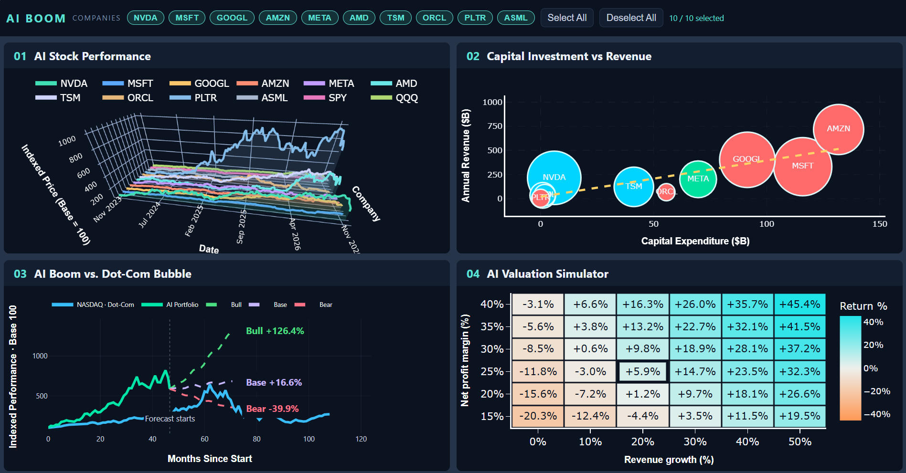
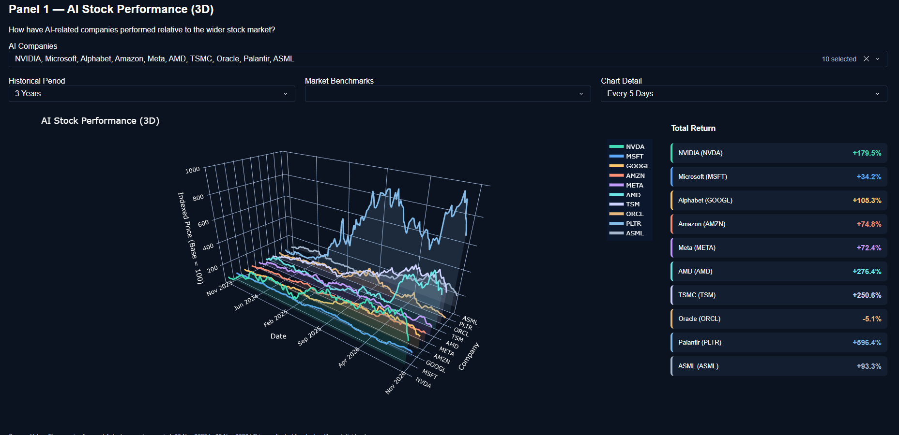
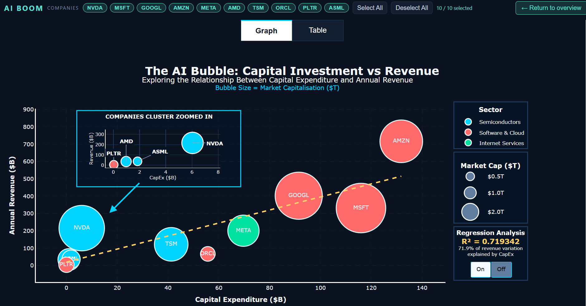
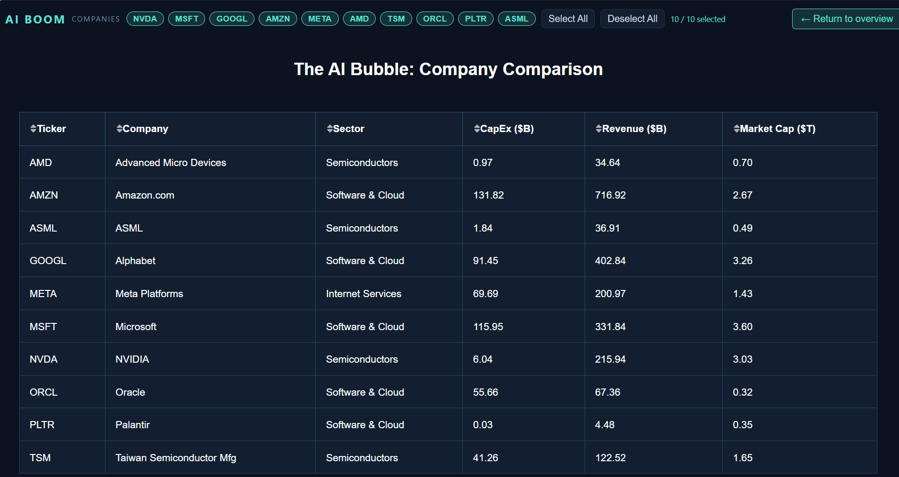
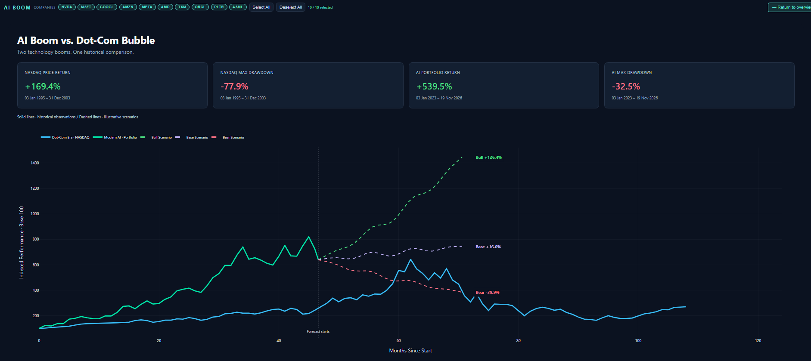
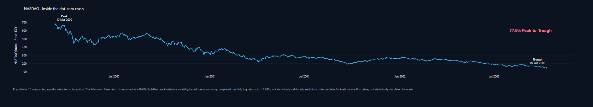
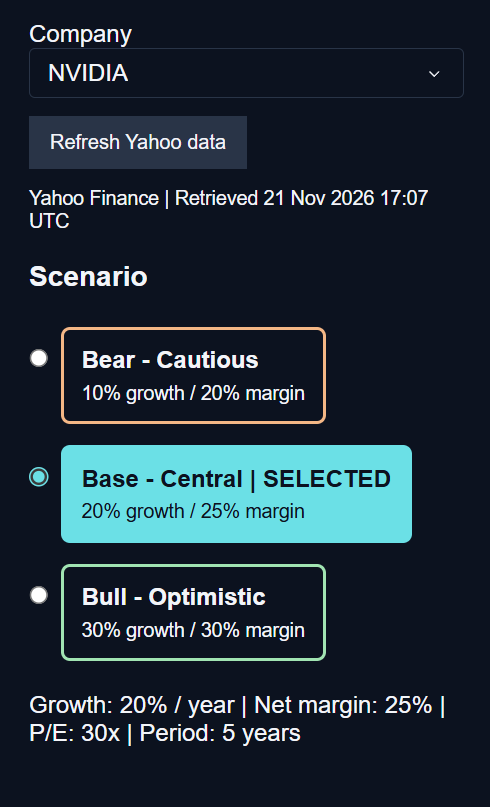
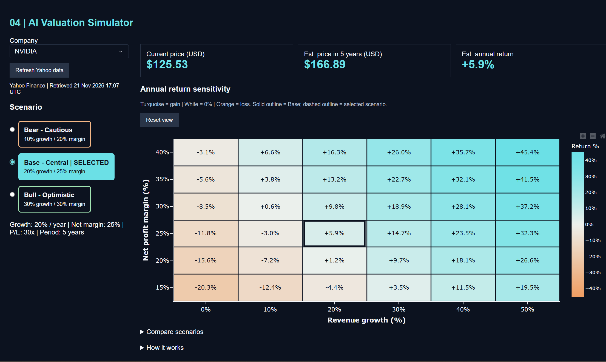

# AI Boom Dashboard

An interactive Python dashboard exploring AI-related stock performance, corporate investment, historical market comparisons, and hypothetical future valuations. It runs on your computer and opens in your browser.

| Panel | Name | Question explored | Main output |
|---|---|---|---|
| 1 — AI Stock Performance | Fionn Ó Nuanáin  | How have selected companies performed against market benchmarks? | 3D performance chart and risk statistics |
| 2 — Capital Investment vs Revenue | Michael Keane | How does company investment relate to revenue? | Bubble chart, regression, and financial table |
| 3 — AI Boom vs Dot-Com Bubble | David Lambe | How does the AI portfolio compare with the dot-com period? | Historical comparison and illustrative scenarios |
| 4 — AI Valuation Simulator | Conan Fennell | What future price follows from selected financial assumptions? | Price estimates, scenario comparison, and sensitivity heatmap |


**Dashboard overview:** 



## 1. Opening the dashboard

### What you need

- Python installed. The original project documentation identifies **Python 3.14** as the development version.
- An internet connection to retrieve financial data.
- A modern browser, such as Chrome, Edge, or Firefox.
- The extracted project folder. VS Code is optional.

If Python is not installed, download it from [python.org](https://www.python.org/downloads/). When installing on Windows, select **Add Python to PATH** if offered.

### First launch — Windows

1. Right-click the ZIP and select **Extract All**.
2. Open the extracted folders until you reach **Group_Project**. You should see `app.py` and the `panels` folder.
3. Right-click an empty space inside that folder and select **Open in Terminal**. Alternatively, open the folder in VS Code and choose **Terminal → New Terminal**.
4. Run each command below separately. Wait for each to finish before entering the next.

Check that Python is available:

```powershell
python --version
```

Install the packages used by the supplied application:

```powershell
python -m pip install dash plotly yfinance pandas numpy flask
```

Start the dashboard:

```powershell
python app.py
```

5. Open **[http://127.0.0.1:8050](http://127.0.0.1:8050)** in your browser.

The application prints the local address in the terminal. Allow time for the charts to retrieve financial data. **Keep the terminal open while using the dashboard.**

**Startup screenshot:** [Insert the terminal showing successful startup and the local address.]

### Stopping and opening again

- **Stop:** click the terminal and press **Ctrl+C**.
- **Open again:** open a terminal in `Group_Project`, run `python app.py`, and visit the same address. You do not need to repeat installation.

## 2. First walkthrough

1. **Choose companies:** click the company buttons at the top. Highlighted companies are included. **Select All** and **Deselect All** change the whole selection.
2. **Open a panel:** click one of the four overview charts.
3. **Explore:** hover over the chart for values and use the expanded panel's controls.
4. **Return:** use the back control to return to the overview.

The top company selector controls **Panels 1–3**. **Panel 4 has its own company selector.** Selecting no companies displays a prompt in Panels 1–3.

| Company | Ticker | Company | Ticker |
|---|---|---|---|
| NVIDIA | NVDA | AMD | AMD |
| Microsoft | MSFT | TSMC | TSM |
| Alphabet | GOOGL | Oracle | ORCL |
| Amazon | AMZN | Palantir | PLTR |
| Meta | META | ASML | ASML |

## 3. Panel guides

### Panel 1 — AI Stock Performance (3D)

Shows how AI-related companies have performed relative to the wider stock market. Every company and two market benchmarks are drawn on one 3D chart, with each company's total return listed beside it.

### Figure 1(a)
[Panel 1 inside the dashboard with all 10 companies selected in the header, a 3-year period, and SPY and QQQ as benchmarks](docs/panel1-dashboard.png)


#### Controls

| Control | Where | Options | Default |
| --- | --- | --- | --- |
| Companies | Header buttons at top of dashboard | NVDA, MSFT, GOOGL, AMZN, META, AMD, TSM, ORCL, PLTR, ASML | All 10 |
| Historical Period | Panel | 1, 3, 5 or 10 years | 3 Years |
| Market Benchmarks | Panel | S&P 500 ETF (SPY), Nasdaq-100 ETF (QQQ); either, both or none | Both |
| Chart Detail | Panel | Daily, Every 5 Days, Every 20 Days | Every 5 Days |
| Refresh Yahoo data | Panel | Reloads the latest prices | n/a |
| Price Scale | Panel | Linear or Log | Linear |
In the dashboard, click a company button in the header to add or remove it. Select All and Deselect All change every selected company at once, and the counter (for example "10 / 10 selected") shows how many are on. Panel 1 shows the companies chosen there. Deselecting all will create a 'Please select at least one AI company' text.

Chart Detail sets how many prices are plotted: Daily uses every trading day, Every 5 Days about one point a week, and Every 20 Days about one a month. Fewer points draw faster and look smoother. The latest price is always included, and total return is not affected.
Price Scale sets how the vertical axis is drawn. Linear spaces the values evenly, so a company that has grown far more than the others, such as NVIDIA over a longer period, can dominate the chart and flatten the rest. Log spaces the values by percentage change, so equal steps up the axis mean equal percentage gains, and every company stays easy to read. Switching the scale only changes how the chart looks. The prices and the total return shown in the cards stay the same.

### Figure 1(b)
[Panel 1 running on its own, with the AI Companies dropdown](image/panel1-standalone.png)



#### Reading the chart

Drag to rotate, scroll to zoom, and hover over a line for its value. Date runs along one axis, company along another, and indexed price upwards. Line colours match the legend and the Total Return list.

- **Indexed price:** every line starts at 100, so companies with different share prices can be compared. A value of 150 means a 50% rise from the start.
- **Total return:** the percentage change from the first to the last date, shown for each company and benchmark.
- **Against the market:** because all lines start at 100, a company that ends above the SPY or QQQ line beat that benchmark over the period.

#### Good to know

- Prices come from Yahoo Finance (via yfinance), need an internet connection, and are adjusted for stock splits and dividends. Use Refresh Yahoo data to reload.
- If a company has less history than the period you chose, the chart starts at the first date all selected companies have data. The actual dates are shown under the chart.
- A company or benchmark with no data is named under "Data unavailable for:" and left out of the chart.
- The chart shows past performance only. It is not a forecast or investment advice.

### Panel 2 — Capital Investment vs Revenue

#### Purpose and Overview

Panel 2 investigates the relationship between capital expenditure (CapEx), annual revenue and market capitalisation across ten major AI-related companies.

The panel combines an interactive bubble chart, linear regression analysis, a zoomed-in comparison of smaller companies and a financial data table. All financial metrics are retrieved from Yahoo Finance and standardised into US dollars to enable comparisons.

#### Understanding the Bubble Chart

Each bubble represents one company, with three financial variables determining its position and size.

| Variable | Chart Representation | Explanation |
|---|---|---|
| Capital Expenditure | X-axis ($B) | Annual spending on long-term assets and infrastructure. |
| Annual Revenue | Y-axis ($B) | Total revenue generated during the selected financial year. |
| Market Capitalisation | Bubble size ($T) | Current market value of the company's equity. |
| Industry Sector | Bubble colour | Groups companies according to their assigned sector. |

**Sector classifications:**

- **Semiconductors (Cyan):** NVDA, AMD, TSM, ASML.
- **Software & Cloud (Red):** MSFT, GOOGL, AMZN, ORCL, PLTR.
- **Internet Services (Green):** META.

#### How to Use Panel 2

1. **Select companies:** Use the universal company selector at the top of the dashboard to include or exclude companies.
2. **Open Panel 2:** Select the chart from the dashboard overview to access its expanded view.
3. **Explore the graph:** Hover over bubbles to inspect financial values and compare companies.
4. **Examine the inset:** Use the zoomed-in chart to compare NVDA, AMD, ASML and PLTR where valid data is available.
5. **Toggle regression:** Use the **On/Off** buttons to show or hide the regression line and R² statistic.
6. **Switch to Table:** Select the **Table** tab to inspect the underlying company data, with sortable columns.

---

#### Data Collection and Financial Statement Selection

Financial information is retrieved using Python's `yfinance` library. For each company, the program creates a `yf.Ticker()` object and accesses three main data sources:

| Data Source | Python Attribute | Information Retrieved |
|---|---|---|
| Company Information | `company.info` | Company name, market capitalisation and reporting currencies. |
| Income Statement | `company.income_stmt` | Annual total revenue. |
| Cash Flow Statement | `company.cashflow` | Annual capital expenditure. |

**Selecting the financial year**

The program identifies the financial reporting dates that appear in **both** the income statement and cash flow statement using:

```python id="cayb3s"
common_years = income.columns.intersection(cashflow.columns)
```

These dates are sorted from newest to oldest. The program selects the **most recent common financial year with valid revenue and CapEx values**.

This ensures both variables relate to the same company's reporting period rather than combining figures from different financial years.

The exact statement entries used are:

- **Revenue:** `Total Revenue` from the annual income statement.
- **Capital expenditure:** `Capital Expenditure` from the annual cash flow statement.

CapEx is converted to a positive value using `abs()`, since capital investment is commonly represented as a negative cash outflow in financial statements.

> **Financial reporting distinction:** Revenue and CapEx are annual flow variables, whereas market capitalisation is a current market valuation. They therefore require different approaches to currency conversion.

---

#### Currency Conversion and Standardisation

The selected companies report financial information in different currencies. To ensure meaningful comparisons, the dashboard converts all values into US dollars (USD).

The code distinguishes between two currency fields from Yahoo Finance:

- `financialCurrency`: The currency used in the company's financial statements.
- `currency`: The currency associated with its market quotation and market capitalisation.

These currencies are not necessarily identical.

##### 1. Revenue and CapEx — Historical Average Exchange Rate

For companies with non-USD financial statements, the program retrieves historical exchange rates covering approximately one year before the selected financial year-end.

The relevant Yahoo Finance FX ticker is constructed as:

```python id="dwll09"
fx_ticker = f"{currency}USD=X"
```

The program calculates the arithmetic mean of the available daily closing exchange rates over the selected reporting window:

```python id="0dnd20"
fx_rate = fx_data['Close'].dropna().mean()
```

Revenue and CapEx are then converted using:

```python id="rjhmn6"
revenue = rev * fx_rate / 1e9
capex = abs(expenditure) * fx_rate / 1e9
```

Dividing by `1e9` expresses both financial metrics in **USD billions ($B)**.

##### 2. Market Capitalisation — Latest Available Exchange Rate

Unlike annual revenue and CapEx, market capitalisation represents a valuation at a particular point in time.

The program retrieves the market capitalisation from:

```python id="4110ea"
cap = info.get('marketCap')
```

Where the market quotation currency is not USD, the program downloads the most recent five days of exchange-rate data and selects the **latest available closing rate**.

```python id="lecmju"
fx_rate_market = fx_data['Close'].dropna().iloc[-1]
cap = cap * fx_rate_market
```

The converted market capitalisation is divided by `1e12` to display it in **USD trillions ($T)**.

##### Currency Conversion Summary

| Financial Metric | Exchange Rate Used | Reason |
|---|---|---|
| Annual Revenue | Historical average over reporting year | Revenue accumulates throughout the year. |
| Capital Expenditure | Historical average over reporting year | Investment expenditure occurs throughout the year. |
| Market Capitalisation | Latest available closing rate | Market capitalisation is a current point-in-time valuation. |

Companies reporting in USD do not require currency conversion.

If a required exchange rate is missing or invalid, the company's values are excluded from the calculations rather than using an unreliable conversion.

---

#### Data Cleaning and Validation

Before plotting, the program validates the financial data using `pandas` and `NumPy`.

The main cleaning operations are:

1. Convert financial columns into numeric values.
2. Replace infinite values with missing values (`NaN`).
3. Remove observations missing revenue, CapEx or market capitalisation.
4. Exclude observations containing zero or negative values for these metrics.
5. Retain the remaining valid companies for the graph, table and regression.

A failed request for one company does not automatically prevent the remaining companies from loading.

Instead, the unavailable company is omitted and the dashboard continues using valid observations.

---

#### Linear Regression and R² Analysis

Panel 2 uses simple linear regression to examine the relationship between capital expenditure and annual revenue.

The model is:

`Revenue = Intercept + Slope × Capital Expenditure`

Where:

- **Dependent variable (Y):** Annual Revenue ($B).
- **Independent variable (X):** Capital Expenditure ($B).
- **Intercept:** Estimated revenue when CapEx equals zero.
- **Slope:** Estimated change in revenue associated with an additional $1 billion of CapEx.

The regression coefficients are calculated using NumPy:

```python id="6i3dzr"
slope, intercept = np.polyfit(x, y, 1)
```

The fitted values are calculated as:

```python id="ahaxfb"
predicted = intercept + slope * x
```

##### Coefficient of Determination (R²)

R² measures the proportion of variation in annual revenue explained by the fitted linear relationship with CapEx.

For example, an R² of `0.75` indicates that **75% of the observed variation in revenue is explained by the fitted linear model** within the selected company sample.

##### Regression Requirements

The regression is only calculated when:

- At least **three companies** have valid data.
- Capital expenditure contains at least two distinct values.
- Annual revenue contains at least two distinct values.

If these conditions are not met, the panel displays **Regression unavailable** instead of producing a misleading result.

Users can also toggle the regression line and its statistics on or off.

> **Interpretation:** Regression identifies an association, not causation. Higher CapEx does not necessarily cause higher revenue, and differences in company size, business models and reporting periods can influence the relationship.

---

#### Zoomed-In Company Comparison (Inset Chart)

Companies with lower revenue and CapEx cluster near the origin, so a zoomed-in inset allows for clearer comparison of **NVIDIA (NVDA), AMD, ASML and Palantir (PLTR)**.

The inset uses the **same underlying financial observations** as the main chart, but applies its own axis ranges to make smaller values easier to distinguish.

---

#### Financial Data Table

The **Table** tab displays the underlying company data used in the chart and regression, including company name, ticker, sector, CapEx ($B), revenue ($B) and market capitalisation ($T).

Values are displayed to two decimal places, and users can sort the table by column.

---

#### Limitations

- **Reporting periods:** Revenue and CapEx are drawn from each company's latest matching financial year, which may differ across companies.
- **Currency conversion:** Historical average FX rates approximate the conversion of annual financial flows.
- **External data:** Results depend on the availability and accuracy of Yahoo Finance information.
- **Regression:** The analysis uses a small, selected sample of companies and identifies correlation rather than causation.

Panel 2 provides a comparative financial analysis rather than a forecast of future revenue or stock market performance.

---

#### Panel 2 Screenshots

**Figure 2(a) — Capital Investment vs Revenue**



*Main bubble chart showing capital expenditure, annual revenue, market capitalisation, sector classifications, regression analysis and the zoomed-in company comparison.*

**Figure 2(b) — Financial Data Table**



*Company-level financial data used in the chart, displayed in USD billions and trillions.*

---

### Panel 3 — AI Boom vs. Dot-Com Bubble

#### Purpose and rationale

Panel 3 compares the historical dot-com bubble with the modern AI boom to investigate similarities and differences in stock market performance during two periods of rapid technological development.

The aim is to visualise historical market behaviour rather than suggest that the current AI boom will necessarily follow the same trajectory as the dot-com bubble.

#### How to use Panel 3

1. **Select AI companies:** Use the universal company selector at the top of the dashboard to include or exclude any of the ten AI companies. Use **Select All** or **Deselect All** to change the entire selection.
2. **Open Panel 3:** Click the AI Boom vs. Dot-Com Bubble chart on the dashboard overview to access its expanded view.
3. **Compare historical performance:** Examine the NASDAQ dot-com period (blue) against the modern AI portfolio (green). Both begin at an indexed value of 100 and are aligned by months elapsed since their respective starting dates.
4. **Explore the forecasts:** The dashed Bull (green), Base (purple) and Bear (red) lines show illustrative 24-month scenarios for the selected AI portfolio.
5. **Review the performance metrics:** The four KPI cards display NASDAQ price return, NASDAQ maximum drawdown, AI portfolio return and AI maximum drawdown.
6. **Examine the dot-com crash:** Scroll down to the second graph to see the NASDAQ's historical peak-to-trough decline between March 2000 and October 2002.
7. **Interact with the charts:** Hover over the lines to inspect values, or change the company selection to see how the AI portfolio and its forecasts respond.

#### Data collection and portfolio construction

Historical price data is retrieved using Python's `yfinance` library. The panel compares the NASDAQ Composite Index from 1995–2003 with a portfolio of selected AI-related companies from January 2023 onwards.

Using `pandas`, the datasets are cleaned and aligned, with missing observations removed where necessary. All prices are indexed to a starting value of 100, allowing the performance of assets with different share prices to be compared directly.

The AI portfolio assumes an equal initial investment in each selected company. The portfolio value is calculated as the arithmetic mean of the individual indexed stock prices. The portfolio is not periodically rebalanced, meaning company weights naturally change as their prices rise or fall.

Both historical series are displayed against months elapsed since their respective starting dates, rather than calendar dates. This makes their trajectories easier to compare.

#### Forecasting methodology

The panel extends the AI portfolio with three illustrative 24-month scenarios: Bull, Base and Bear.

The **Base scenario** assumes a cumulative return of +16.6% over 24 months.

To construct the Bull and Bear scenarios, I used `pandas` to extract completed month-end portfolio observations and `NumPy` to calculate logarithmic returns. The sample standard deviation of these returns measures historical monthly volatility.

The scenario spread is calculated as:

`Spread = 1.645 × monthly volatility × √24`

This spread is applied symmetrically in log-return space around the assumed Base outcome:

- **Bull:** `1.166 × exp(Spread) − 1`
- **Base:** `+16.6%`
- **Bear:** `1.166 × exp(−Spread) − 1`

All three forecast paths begin at the latest available AI portfolio value. NumPy is also used to generate smooth intermediate paths that reach the calculated scenario endpoints.

These paths are illustrative, not statistically simulated forecasts. The Base return is an assumption, while the Bull and Bear outcomes depend on historical volatility and the chosen scenario spread.

#### Python implementation and interactive features

The panel combines several Python libraries:

- **yfinance:** Retrieves historical NASDAQ and AI company prices.
- **pandas:** Cleans and aligns datasets, constructs the portfolio, calculates returns and identifies monthly observations.
- **NumPy:** Performs logarithmic-return, volatility and forecast-path calculations.
- **Plotly:** Creates the interactive historical comparison, scenario lines, annotations and hover information.
- **Dash:** Builds the expanded panel, performance cards and interactive integration with the main dashboard.

The panel also uses Python's `functools.lru_cache` to avoid unnecessary repeated calculations and downloads for identical requests.

The universal company selector allows users to change the composition of the AI portfolio. The panel then recalculates its performance and scenario outcomes.

The expanded view also includes four key performance indicators: NASDAQ price return, NASDAQ maximum drawdown, AI portfolio return and AI maximum drawdown. A separate chart examines the historical NASDAQ peak-to-trough decline in greater detail.

#### Limitations

The historical comparison is descriptive and does not establish that the AI market will experience a crash similar to the dot-com bubble.

The two periods differ in economic conditions, market composition and company characteristics. The AI portfolio is also sensitive to which companies are selected and the common starting date available for their prices.

The forecasts depend on an assumed Base return and historical volatility. They should therefore be interpreted as hypothetical scenarios rather than reliable predictions or investment recommendations.

#### Panel 3 Screenshots

**Figure 3a — AI Boom vs. Dot-Com Bubble**



*The expanded Panel 3, showing the universal company selector, performance metrics and 24-month Bull, Base and Bear scenarios.*

**Figure 3b — NASDAQ Dot-Com Crash Detail**



*Historical NASDAQ performance from its March 2000 peak to October 2002 trough, showing a 77.9% decline.*


### Panel 4 — AI Valuation Simulator

#### Purpose and Overview

Panel 4 examines how revenue growth, profitability and valuation assumptions affect a company's potential future share price.

Using financial data from Yahoo Finance, the simulator calculates an estimated future share price and annualised return under three scenarios: **Bear, Base and Bull**.

An interactive sensitivity heatmap illustrates how different growth and profit-margin assumptions influence these results.

#### How to Use Panel 4
1. **Select a company:** Choose one of the ten AI-related companies using Panel 4's independent company selector.
2. **Choose a scenario:** Select Bear, Base or Bull to apply different financial assumptions.The Base scenario remains highlighted with a bold outline for reference, while Bear or Bull are highlighted using a dotted outline if chosen. The Compare Scenarios drop-down explains all 3 scenarios side by side.
3. **Review the valuation:** Examine the current share price, estimated future price and annualised return.
4. **Explore the heatmap:** Hover over cells to see how revenue growth and profit margins affect projected returns.
5. **Refresh data:** Select **Refresh Yahoo data** to retrieve updated financial information.


Unlike Panels 1–3, Panel 4 operates independently of the dashboard's universal company selector.

**Figure 4(a) — Bear, Base and Bull Scenario Selection**



*The scenario selector allows users to switch between Bear, Base and Bull assumptions.*

#### Financial Data and Inputs

The simulator retrieves three company-specific inputs using Python's `yfinance` library.

| Input | Purpose |
|---|---|
| Annual revenue | Starting point for projecting future earnings |
| Equivalent shares outstanding | Converts projected earnings into earnings per share |
| Current share price | Determines the potential investment return |

The program uses the latest available annual revenue, checks the consistency of share-price and share-count data, and converts reported revenue into USD where necessary.

#### How the Valuation Is Calculated

The simulator uses an **earnings-multiple valuation model**, following four calculations:

**1. Project future revenue**

Future Revenue = Current Revenue × (1 + Growth Rate)^Years

**2. Calculate future earnings per share (EPS)**

Future EPS = Future Revenue × Net Profit Margin ÷ Shares Outstanding

**3. Estimate future share price**

Future Share Price = Future EPS × Future P/E Ratio

**4. Calculate annualised return**

Annualised Return = (Future Price ÷ Current Price)^(1 / Years) − 1

**Worked Example**

Assume a company has $50 billion in annual revenue, 5 billion shares outstanding, a current share price of $100, 20% annual revenue growth, a 25% net profit margin and a future P/E ratio of 30 over five years.

| Calculation | Result |
|---|---:|
| Future revenue: $50bn × 1.20⁵ | $124.42bn |
| Future net income: $124.42bn × 25% | $31.10bn |
| Future EPS: $31.10bn ÷ 5bn shares | $6.22 |
| Future share price: $6.22 × 30 | **$186.62** |
| Annualised return: ($186.62 ÷ $100)^(1/5) − 1 | **13.3%** |

Under these assumptions, the company's estimated share price rises from **$100 to $186.62**, equivalent to an annualised return of approximately **13.3%**.

A 25% net margin means the company earns $0.25 in profit per $1 of revenue. A P/E of 30 values each $1 of annual earnings per share at $30.

#### Why Results Differ Between Companies

Although companies use the same scenario assumptions, each starts with different financial data.

- **Revenue:** Determines the starting scale of projected earnings.
- **Shares outstanding:** Determines the earnings attributable to each share.
- **Current share price:** Determines whether the projected future price represents a gain or loss.

For example, two companies could generate identical future earnings per share but different annualised returns because their current share prices differ.

Therefore, **higher projected earnings do not necessarily mean higher investment returns**. The price investors pay today also matters.

#### Scenario Analysis

The simulator applies three predefined sets of assumptions over a five-year period.

| Scenario | Annual Revenue Growth | Net Profit Margin | Future P/E |
|---|---:|---:|---:|
| Bear | 10% | 20% | 30× |
| Base | 20% | 25% | 30× |
| Bull | 30% | 30% | 30× |

The same assumptions are applied to each company's starting financial data, enabling consistent comparisons.

The **Compare scenarios** feature displays the estimated future share price and annualised return for all three scenarios.

#### Understanding the Sensitivity Heatmap

The interactive heatmap calculates estimated annualised returns across different combinations of revenue growth and net profit margin.

| Element | Meaning |
|---|---|
| X-axis | Annual revenue growth (%) |
| Y-axis | Net profit margin (%) |
| Cell value | Estimated annualised return (%) |
| Turquoise | Positive return |
| White | Approximately zero return |
| Orange | Negative return |
| Solid outline | Base scenario |
| Dashed outline | Selected scenario, when different from Base |

Each cell repeats the valuation calculation using a different growth rate and profit margin, while holding the future P/E ratio and investment horizon constant.

**Moving right** increases assumed revenue growth, while **moving up** increases assumed profitability. Both increase the estimated return, all else equal.

Hovering over a cell displays the relevant assumptions, estimated future share price and annualised return.

**Figure 4(b) — Individual Panel 4 View**



*Expanded Panel 4 showing the selected company's valuation results and the interactive annual-return sensitivity heatmap.*

#### Model Assumptions and Limitations

- **Constant assumptions:** Revenue growth, net margin, share count and future P/E are held constant throughout the projection.
- **Data dependency:** Results depend on the accuracy and availability of Yahoo Finance data.
- **Excluded factors:** Dividends, share dilution, taxes and trading costs are excluded.
- **Valuation method:** The model uses projected earnings and a future P/E multiple rather than discounted cash flow analysis.
- **Forecast uncertainty:** Bear, Base and Bull represent illustrative scenarios, not guaranteed outcomes.

**Panel 4 is designed to explore valuation sensitivity and potential investment outcomes, not to predict future stock prices or provide investment advice.**

---


## 4. Data and implementation

Financial data is retrieved from **Yahoo Finance through yfinance**. The application combines historical prices, financial statements, portfolio calculations, linear regression, and valuation modelling.

- Internet access is required for retrieval; market data is not bundled with the application.
- Missing source data can prevent charts or calculations from loading.
- Selected data requests are cached in memory for **15 minutes**.
- Financial values change between runs; screenshots are dated examples.
- Historical data and hypothetical scenarios should be interpreted separately.

**Architecture:** `app.py` combines the panel modules and manages navigation. Dash updates outputs when controls change; Plotly draws the charts; pandas and NumPy process data; Flask provides the local web server.

## Project Structure

```text
Group_Project/
├── app.py
├── README.md
├── requirements.txt
├── panels/
│   ├── dashboard_shared.py
│   ├── panel1_stock.py
│   ├── panel2_valuation.py
│   ├── panel3_dotcom.py
│   └── panel4_simulator.py
└── screenshots/
    ├── final_dashboard.png
    ├── image.png
    ├── panel1_dashboard.png
    ├── panel2_graph_dashboard.png
    ├── panel2_table_dashboard.png
    ├── panel3_crash.png
    ├── panel3_main.png
    ├── panel4_full.png
    └── panel4_scenarios.png
```

## 5. Troubleshooting

| Problem | What to do |
|---|---|
| `python` is not recognised | Try `py --version`. If it works, replace `python` with `py` in the commands. Otherwise install Python and reopen the terminal. |
| `app.py` cannot be found | Open the terminal in `Group_Project`, where `app.py` is visible. |
| A package is missing | Repeat the installation command in Section 1 using the same Python installation used to launch the app. |
| `panels` cannot be imported | Keep `app.py` and the complete `panels/` folder together. |
| Browser cannot connect | Confirm the app is still running and use the address displayed in the terminal. |
| Port 8050 is occupied | Run `python app.py --port 8051`, then open `http://127.0.0.1:8051`. |
| Financial data is unavailable | Check internet access and refresh where available. |

## 6. References and attribution

The dashboard uses the following data sources, libraries and documentation:

| Resource | Reference |
|---|---|
| Python | [Python Documentation](https://docs.python.org/3/) |
| Dash | [Dash Documentation](https://dash.plotly.com/) |
| Plotly | [Plotly Python Documentation](https://plotly.com/python/) |
| Yahoo Finance | [Yahoo Finance](https://finance.yahoo.com/) |
| yfinance | [yfinance GitHub Repository](https://github.com/ranaroussi/yfinance) |
| pandas | [pandas Documentation](https://pandas.pydata.org/docs/) |
| NumPy | [NumPy Documentation](https://numpy.org/doc/) |
| Flask | [Flask Documentation](https://flask.palletsprojects.com/) |
| Matplotlib | [Matplotlib Documentation](https://matplotlib.org/) |

---
