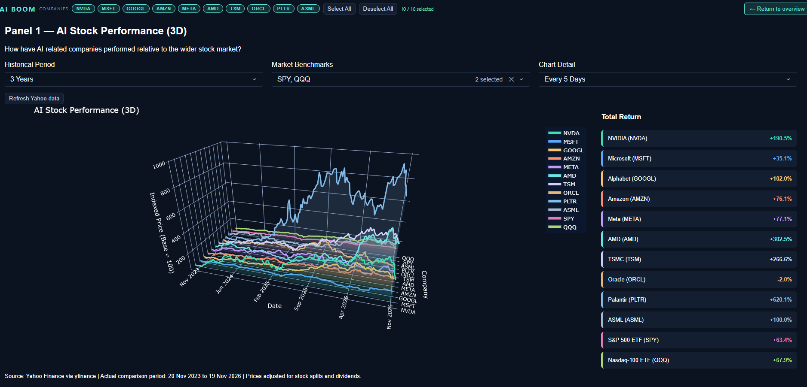

# AI Boom Dashboard

An interactive Python dashboard exploring AI-related stock performance, corporate investment, historical market comparisons, and hypothetical future valuations. It runs on your computer and opens in your browser.

| Panel | Question explored | Main output |
|---|---|---|
| 1 — AI Stock Performance | How have selected companies performed against market benchmarks? | 3D performance chart and risk statistics |
| 2 — Capital Investment vs Revenue | How does company investment relate to revenue? | Bubble chart, regression, and financial table |
| 3 — AI Boom vs Dot-Com Bubble | How does the AI portfolio compare with the dot-com period? | Historical comparison and illustrative scenarios |
| 4 — AI Valuation Simulator | What future price follows from selected financial assumptions? | Price estimates, scenario comparison, and sensitivity heatmap |

**Dashboard overview:** [Insert a screenshot showing the four panels and company selector. Record the capture date.]

## 1. Opening the dashboard

### What you need

- Python installed. The original project documentation identifies **Python 3.14** as the development version.
- An internet connection to retrieve financial data.
- A modern browser, such as Chrome, Edge, or Firefox.
- The extracted project folder. VS Code is optional.

If Python is not installed, download it from [python.org](https://www.python.org/downloads/). When installing on Windows, select **Add Python to PATH** if offered.

### First launch — Windows

1. Right-click the ZIP and select **Extract All**.
2. Open the extracted folders until you reach **Group_Project**. You should see `app.py` and the `panels` folder.
3. Right-click an empty space inside that folder and select **Open in Terminal**. Alternatively, open the folder in VS Code and choose **Terminal → New Terminal**.
4. Run each command below separately. Wait for each to finish before entering the next.

Check that Python is available:

```powershell
python --version
```

Install the packages used by the supplied application:

```powershell
python -m pip install dash plotly yfinance pandas numpy flask
```

Start the dashboard:

```powershell
python app.py
```

5. Open **[http://127.0.0.1:8050](http://127.0.0.1:8050)** in your browser.

The application prints the local address in the terminal. Allow time for the charts to retrieve financial data. **Keep the terminal open while using the dashboard.**

**Startup screenshot:** [Insert the terminal showing successful startup and the local address.]

### Stopping and opening again

- **Stop:** click the terminal and press **Ctrl+C**.
- **Open again:** open a terminal in `Group_Project`, run `python app.py`, and visit the same address. You do not need to repeat installation.

## 2. First walkthrough

1. **Choose companies:** click the company buttons at the top. Highlighted companies are included. **Select All** and **Deselect All** change the whole selection.
2. **Open a panel:** click one of the four overview charts.
3. **Explore:** hover over the chart for values and use the expanded panel's controls.
4. **Return:** use the back control to return to the overview.

The top company selector controls **Panels 1–3**. **Panel 4 has its own company selector.** Selecting no companies displays a prompt in Panels 1–3.

| Company | Ticker | Company | Ticker |
|---|---|---|---|
| NVIDIA | NVDA | AMD | AMD |
| Microsoft | MSFT | TSMC | TSM |
| Alphabet | GOOGL | Oracle | ORCL |
| Amazon | AMZN | Palantir | PLTR |
| Meta | META | ASML | ASML |

## 3. Panel guides

### Panel 1 — AI Stock Performance (3D)

Shows how AI-related companies have performed relative to the wider stock market. Every company and two market benchmarks are drawn on one 3D chart, with each company's total return listed beside it.

### Figure 1(a)
[Panel 1 inside the dashboard with all 10 companies selected in the header, a 3-year period, and SPY and QQQ as benchmarks](docs/panel1-dashboard.png)


#### Controls

| Control | Where | Options | Default |
| --- | --- | --- | --- |
| Companies | Dashboard: header buttons. (Panel_1 run on its own: "AI Companies" dropdown) | NVDA, MSFT, GOOGL, AMZN, META, AMD, TSM, ORCL, PLTR, ASML | All 10 |
| Historical Period | Panel | 1, 3, 5 or 10 years | 3 Years |
| Market Benchmarks | Panel | S&P 500 ETF (SPY), Nasdaq-100 ETF (QQQ); either, both or none | Both |
| Chart Detail | Panel | Daily, Every 5 Days, Every 20 Days | Every 5 Days |
| Refresh Yahoo data | Panel | Reloads the latest prices | n/a |

In the dashboard, click a company button in the header to add or remove it. Select All and Deselect All change every company at once, and the counter (for example "10 / 10 selected") shows how many are on. Panel 1 shows the companies chosen there.

Chart Detail sets how many prices are plotted: Daily uses every trading day, Every 5 Days about one point a week, and Every 20 Days about one a month. Fewer points draw faster and look smoother. The latest price is always included, and total return is not affected.

### Figure 1(b)
[Panel 1 running on its own, with the AI Companies dropdown](docs/panel1-standalone.png)

![alt text]

#### Reading the chart

Drag to rotate, scroll to zoom, and hover over a line for its value. Date runs along one axis, company along another, and indexed price upwards. Line colours match the legend and the Total Return list.

- **Indexed price:** every line starts at 100, so companies with different share prices can be compared. A value of 150 means a 50% rise from the start.
- **Total return:** the percentage change from the first to the last date, shown for each company and benchmark.
- **Against the market:** because all lines start at 100, a company that ends above the SPY or QQQ line beat that benchmark over the period.

#### Good to know

- Prices come from Yahoo Finance (via yfinance), need an internet connection, and are adjusted for stock splits and dividends. They are cached for 15 minutes. Use Refresh Yahoo data to reload.
- If a company has less history than the period you chose, the chart starts at the first date all selected companies have data. The actual dates are shown under the chart.
- A company or benchmark with no data is named under "Data unavailable for:" and left out of the chart.
- The chart shows past performance only. It is not a forecast or investment advice.

### Panel 2 — Capital Investment vs Revenue

Select companies, hover over bubbles for details, and switch to the table to inspect the underlying figures.

- **X-axis:** capital expenditure—spending on long-term assets, in USD billions.
- **Y-axis:** annual revenue—sales before expenses, in USD billions.
- **Bubble size:** market capitalisation—the market value of the company's equity.
- **Regression line:** the fitted linear relationship between spending and revenue.
- **R²:** the proportion of variation in revenue explained by that fit within the selected sample.

The relationship does not establish that spending caused the revenue. Company reporting periods and business models may differ.

**Screenshots:** [Show the bubble chart with readable axes and regression information, followed by the financial table.]

### Panel 3 — AI Boom vs. Dot-Com Bubble

#### Purpose and rationale

Panel 3 compares the historical dot-com bubble with the modern AI boom to investigate similarities and differences in stock market performance during two periods of rapid technological development.

The aim is to visualise historical market behaviour rather than suggest that the current AI boom will necessarily follow the same trajectory as the dot-com bubble.

#### Data collection and portfolio construction

Historical price data is retrieved using Python's `yfinance` library. The panel compares the NASDAQ Composite Index from 1995–2003 with a portfolio of selected AI-related companies from January 2023 onwards.

Using `pandas`, the datasets are cleaned and aligned, with missing observations removed where necessary. All prices are indexed to a starting value of 100, allowing the performance of assets with different share prices to be compared directly.

The AI portfolio assumes an equal initial investment in each selected company. The portfolio value is calculated as the arithmetic mean of the individual indexed stock prices. The portfolio is not periodically rebalanced, meaning company weights naturally change as their prices rise or fall.

Both historical series are displayed against months elapsed since their respective starting dates, rather than calendar dates. This makes their trajectories easier to compare.

#### Forecasting methodology

The panel extends the AI portfolio with three illustrative 24-month scenarios: Bull, Base and Bear.

The **Base scenario** assumes a cumulative return of +16.6% over 24 months.

To construct the Bull and Bear scenarios, I used `pandas` to extract completed month-end portfolio observations and `NumPy` to calculate logarithmic returns. The sample standard deviation of these returns measures historical monthly volatility.

The scenario spread is calculated as:

`Spread = 1.645 × monthly volatility × √24`

This spread is applied symmetrically in log-return space around the assumed Base outcome:

- **Bull:** `1.166 × exp(Spread) − 1`
- **Base:** `+16.6%`
- **Bear:** `1.166 × exp(−Spread) − 1`

All three forecast paths begin at the latest available AI portfolio value. NumPy is also used to generate smooth intermediate paths that reach the calculated scenario endpoints.

These paths are illustrative, not statistically simulated forecasts. The Base return is an assumption, while the Bull and Bear outcomes depend on historical volatility and the chosen scenario spread.

#### Python implementation and interactive features

The panel combines several Python libraries:

- **yfinance:** Retrieves historical NASDAQ and AI company prices.
- **pandas:** Cleans and aligns datasets, constructs the portfolio, calculates returns and identifies monthly observations.
- **NumPy:** Performs logarithmic-return, volatility and forecast-path calculations.
- **Plotly:** Creates the interactive historical comparison, scenario lines, annotations and hover information.
- **Dash:** Builds the expanded panel, performance cards and interactive integration with the main dashboard.

The panel also uses Python's `functools.lru_cache` to avoid unnecessary repeated calculations and downloads for identical requests.

The universal company selector allows users to change the composition of the AI portfolio. The panel then recalculates its performance and scenario outcomes.

The expanded view also includes four key performance indicators: NASDAQ price return, NASDAQ maximum drawdown, AI portfolio return and AI maximum drawdown. A separate chart examines the historical NASDAQ peak-to-trough decline in greater detail.

#### Limitations

The historical comparison is descriptive and does not establish that the AI market will experience a crash similar to the dot-com bubble.

The two periods differ in economic conditions, market composition and company characteristics. The AI portfolio is also sensitive to which companies are selected and the common starting date available for their prices.

The forecasts depend on an assumed Base return and historical volatility. They should therefore be interpreted as hypothetical scenarios rather than reliable predictions or investment recommendations.

#### Panel 3 Screenshots

**Figure 3a — AI Boom vs. Dot-Com Bubble**


*The expanded Panel 3, showing the universal company selector, performance metrics and 24-month Bull, Base and Bear scenarios.*

**Figure 3b — NASDAQ Dot-Com Crash Detail**


*Historical NASDAQ performance from its March 2000 peak to October 2002 trough, showing a 77.9% decline.*


### Panel 4 — AI Valuation Simulator

Estimate a hypothetical future share price from assumptions about growth, profitability, and valuation.

#### How to use it

1. Choose a company using this panel's selector.
2. Review the financial data and source dates.
3. Select **Bear**, **Base**, or **Bull**.
4. Compare the estimated future price and annualised return.
5. Hover over the heatmap to explore growth and profit-margin combinations.
6. Expand **Compare scenarios** to view the comparison table.

| Scenario | Annual revenue growth | Net profit margin | Future P/E | Years |
|---|---:|---:|---:|---:|
| Bear | 10% | 20% | 30× | 5 |
| Base | 20% | 25% | 30× | 5 |
| Bull | 30% | 30% | 30× | 5 |

These presets are illustrative assumptions, not company-specific forecasts.

#### Financial basis

The simulator uses an **earnings-multiple model**: grow revenue, estimate profit, calculate earnings per share (EPS), then apply a future price-to-earnings ratio (P/E).

```text
Future revenue = current annual revenue × (1 + growth)^years
Future EPS = future revenue × net profit margin ÷ equivalent shares
Future price = future EPS × future P/E
Annualised return = (future price ÷ current price)^(1 ÷ years) − 1
```

Growth and margin are decimals in these formulas: 20% is `0.20`.

A **25% net profit margin** means $0.25 profit per $1 of revenue. A **30× P/E** means a price equal to 30 times annual earnings per share.

**Example:** $50 billion revenue growing at 20% annually for five years becomes approximately $124.4 billion. At a 25% margin, 5 billion equivalent shares, and a 30× P/E, the estimated future price is **$186.62**.

Annualised return expresses the constant yearly price growth needed to reach the estimate. The heatmap repeats the valuation across growth and margin combinations, keeping the selected scenario's P/E and horizon.

**Limits:** this estimates a future price under assumptions; it does not discount future cash flows to estimate today's intrinsic value. Growth, margin, shares, P/E, and FX are held constant. Dividends, fees, and taxes are excluded.

For American Depositary Share (ADS) listings, the price and equivalent share count must use consistent listing units. **Refresh Yahoo data** restores retrieved figures.

**Screenshots:** [Show company, scenario, assumptions, results, and heatmap. Add the expanded manual-input controls with units visible.]

## 4. Data and implementation

Financial data is retrieved from **Yahoo Finance through yfinance**. The application combines historical prices, financial statements, portfolio calculations, linear regression, and valuation modelling.

- Internet access is required for retrieval; market data is not bundled with the application.
- Missing source data can prevent charts or calculations from loading.
- Selected data requests are cached in memory for **15 minutes**.
- Financial values change between runs; screenshots are dated examples.
- Historical data and hypothetical scenarios should be interpreted separately.

**Architecture:** `app.py` combines the panel modules and manages navigation. Dash updates outputs when controls change; Plotly draws the charts; pandas and NumPy process data; Flask provides the local web server.

```text
Group_Project/
├── app.py
├── README.md
├── requirements.txt
└── panels/
    ├── dashboard_shared.py
    ├── panel1_stock.py
    ├── panel2_valuation.py
    ├── panel3_dotcom.py
    └── panel4_simulator.py
```

## 5. Troubleshooting

| Problem | What to do |
|---|---|
| `python` is not recognised | Try `py --version`. If it works, replace `python` with `py` in the commands. Otherwise install Python and reopen the terminal. |
| `app.py` cannot be found | Open the terminal in `Group_Project`, where `app.py` is visible. |
| A package is missing | Repeat the installation command in Section 1 using the same Python installation used to launch the app. |
| `panels` cannot be imported | Keep `app.py` and the complete `panels/` folder together. |
| Browser cannot connect | Confirm the app is still running and use the address displayed in the terminal. |
| Port 8050 is occupied | Run `python app.py --port 8051`, then open `http://127.0.0.1:8051`. |
| Financial data is unavailable | Check internet access and refresh where available. |

## 6. References and attribution

- [Yahoo Finance](https://finance.yahoo.com/) — financial data.
- [yfinance](https://github.com/ranaroussi/yfinance) — data retrieval.
- [Python](https://docs.python.org/3/), [Dash](https://dash.plotly.com/), [Plotly](https://plotly.com/python/), [pandas](https://pandas.pydata.org/docs/), [NumPy](https://numpy.org/doc/), and [Flask](https://flask.palletsprojects.com/) — application libraries and documentation.
- **External code, resources, and assistance:** [identify sources, their use, and any required declarations under module rules].
